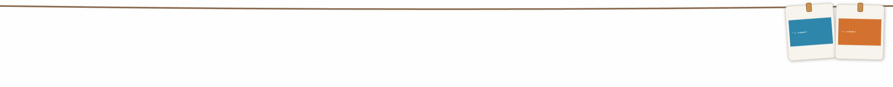

# Clothesline

English | [简体中文](README.zh-CN.md)

A screenshot clothesline for Windows. Every new screenshot gets pegged to a line at the top of your screen; hover the very top edge and the line slides down, move away and it retracts.



Inspired by [tendedero](https://github.com/alejandrobujan/tendedero) (macOS, Swift). This is an independent Windows implementation — per tendedero's license note, the name and icon here are original.

## Requirements

- Windows 10 version 2004 (build 19041) or later, or Windows 11. OCR also needs a Windows OCR language pack.
- [.NET 10 Desktop Runtime](https://dotnet.microsoft.com/download/dotnet/10.0) to run, or the .NET 10 SDK to build

## Usage

| Action | Effect |
| --- | --- |
| Move the mouse to the very top edge of the screen | The line slides down |
| Move the mouse away (or click empty rope) | The line retracts |
| Hotkey (default `Ctrl+Alt+T`) | Toggle the line. On conflict, try `Ctrl+Alt+L` then `Ctrl+Alt+T` (skip chords already tried) and show a tray balloon |
| A new screenshot arrives | The line peeks down for a moment |
| Click a photo | Copy the full-resolution original to the clipboard |
| Double-click | Open in the default image viewer |
| Drag onto an Explorer folder or the desktop | Unpin. The file stays (Explorer copies or moves it) |
| Drag onto the Recycle Bin | Move the file to the Recycle Bin and unpin |
| Drag into a chat / editor | Drop the file; the peg stays on the line |
| Right-click a photo | Open / reveal in folder / pin / OCR / take down / take down and delete |
| Wheel over a photo | Zoom that thumbnail from half to twice the default 184×216 |
| Wheel over empty rope | Scroll horizontally when pegs overflow. This does not zoom |
| Tray icon | Double-click toggles; right-click for the menu (hotkey, clipboard switch, settings, history, open pins, folders, exit) |

The UI is in Chinese. If a drop target is not recognized, the peg stays; use **取下** (take down) or **取下并删除文件** (take down and delete). Delete sends the file to the Recycle Bin.

## Where screenshots come from

1. **Watch folders** — default is `Pictures\Screenshots` (`Win+PrintScreen`, follows OneDrive redirection). Add or remove folders in settings.
2. **Clipboard watch** (can be turned off) — `Win+Shift+S` is saved as a PNG under `%LOCALAPPDATA%\Clothesline\captures`. Optional minimum width and height; `0` means no limit.

Identical content within 6 seconds is deduplicated (one `Win+Shift+S` typically reaches both the clipboard and the auto-save folder; only one peg is created).

## Settings and restarts

The tray item **设置…** edits capacity (default 20, range 1–200), history size (default 50, range 1–500), the clipboard switch and size filter, the hotkey, and the watch-folder list.

`%LOCALAPPDATA%\Clothesline\settings.json` stores that. `%LOCALAPPDATA%\Clothesline\pegs.json` stores the pegs currently on the line (path and angle). They come back after a restart; pegs whose files are gone are dropped. A corrupt `settings.json` exits the app instead of overwriting the file. A corrupt `pegs.json` is renamed to `pegs.json.bad` and the line starts empty.

## Pin, history, OCR

- **贴图 (pin)** does not take the peg off the line. It is a separate always-on-top window: drag to move, use the corner or the wheel to scale, **锁定** to lock position, **穿透** for click-through. Click-through also sets the pin to 50% opacity. After click-through is on, turn it off or close the pin from the tray item **已打开的贴图**. Closing a pin does **not** delete the file, and the peg stays on the line.
- **取下 (take down)** without deleting the file appends `%LOCALAPPDATA%\Clothesline\history.json`. The tray item **历史…** can hang it again or open another pin. Hanging it again removes that history row. The list drops the oldest past the cap, and drops rows whose files are gone.
- **取下并删除文件** and a drop on the Recycle Bin do not enter history. A drop on a folder is recorded only when the original file is still there.
- **识别文字** uses Windows.Media.Ocr and shows the text in its own window. It does **not** copy the text automatically. Select a span and press **复制** to copy that span; with no selection, **复制** copies the whole text. **翻译** opens [Bing Translator](https://www.bing.com/translator) in the default browser (`from=auto`, target `zh-Hans`). A selection is sent alone; otherwise the whole text is sent. Only the first 1000 characters are included. If no language pack is installed, or recognition fails, the app shows a message and keeps running. A normal click still copies the image, not a pin.

Peg thumbnails default to 184×216, twice the 0.3.0 size. The wheel over one photo zooms only that peg. Zooming in grows the line to the tallest peg; zooming out does not shrink the line below the default height. The wheel over empty rope only scrolls sideways.

Pen, arrow, and mosaic annotation are not in this version.

## Known limitations

- Primary screen only; screenshots taken anywhere hang on the primary screen's line.
- While a fullscreen game or presentation is in the foreground, new captures don't auto-peek (they are still pegged; use the hotkey or the top edge).
- The top hotzone is 3 px tall: precise, but it can be blocked by other always-on-top windows covering the screen edge (use the hotkey then).
- Folder and Recycle Bin drops are recognized for Explorer. Other file managers may not report a target; use the context menu then.
- OCR needs a Windows OCR language pack. Translation is Bing Translator in the browser, not an in-app engine. A click-through pin is 50% opaque and is dismissed from the tray.
- No long-screenshot stitching and no global Win+drag capture.

## Building

```text
dotnet build -c Release
dotnet publish -c Release -r win-x64 --self-contained false -p:PublishSingleFile=true
```

No NuGet dependencies — tray icon, clipboard listener, global hotkey and fullscreen detection are all hand-rolled Win32.

Logic that does not need WPF (settings, peg list, hotkey fallback) can be checked on any OS:

```text
dotnet run --project tests/Clothesline.LogicTests.csproj -c Release
```

The window, tray, and hotkey registration run on Windows. On other operating systems a plain `dotnet build` reports `NETSDK1100`; `-p:EnableWindowsTargeting=true` cross-compiles the Windows target, and the app still has to run on Windows.

## Engineering notes (the fun part)

Things that bit during development, in case you build something similar:

- A WPF `Window` does not support `RenderTransform` — it throws. Slide the window itself by animating `Window.Top` instead.
- A `Window`'s theme style fills a **white background** by default: removing the `Background` attribute in XAML is *not* transparency. Set `Background="Transparent"` explicitly.
- **Layered windows hit-test per pixel alpha**: a fully transparent window is mouse-through for the whole system — `MouseEnter` never fires and `WindowFromPoint` lands on the desktop. Paint hit-test areas with **alpha = 1** (`#01000000`): invisible, but hittable.
- Images copied by WeChat (and other apps) arrive as DIBs with **all-zero alpha bytes**. Saving them as-is produces a fully transparent PNG — the image renders invisible. Fix the alpha bytes directly; do **not** use `FormatConvertedBitmap` to convert to `Bgr32`, because conversion passes through premultiplied alpha and an A=0 image turns pitch black.
- One `Clipboard.SetImage` raises several `WM_CLIPBOARDUPDATE` messages — deduplicate.

## License

MIT — see [LICENSE](LICENSE).
